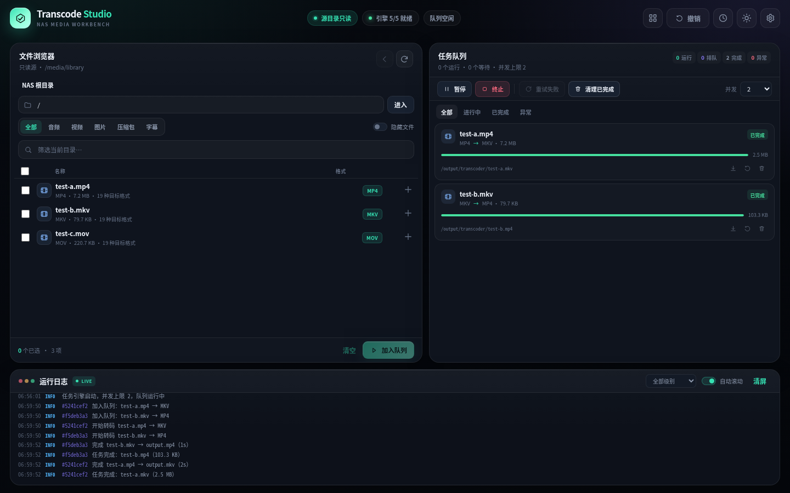
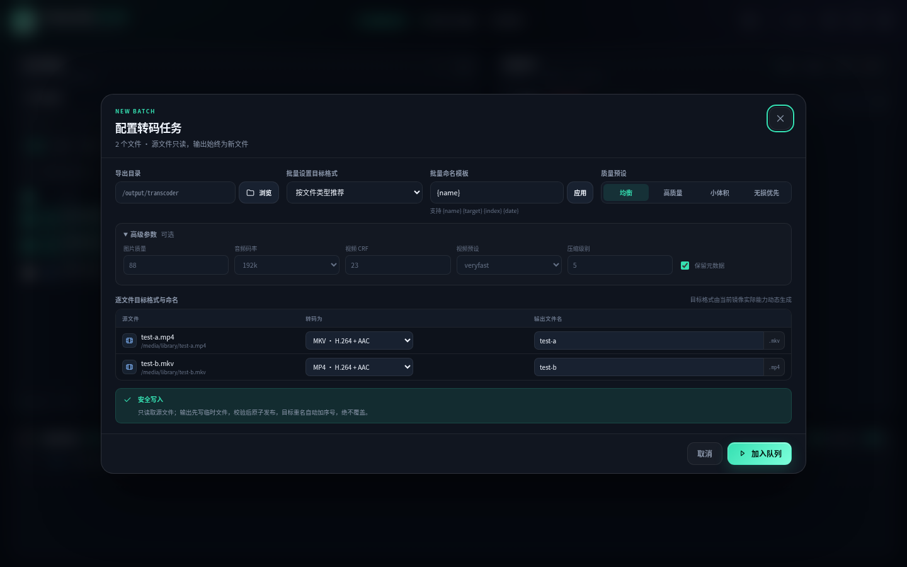
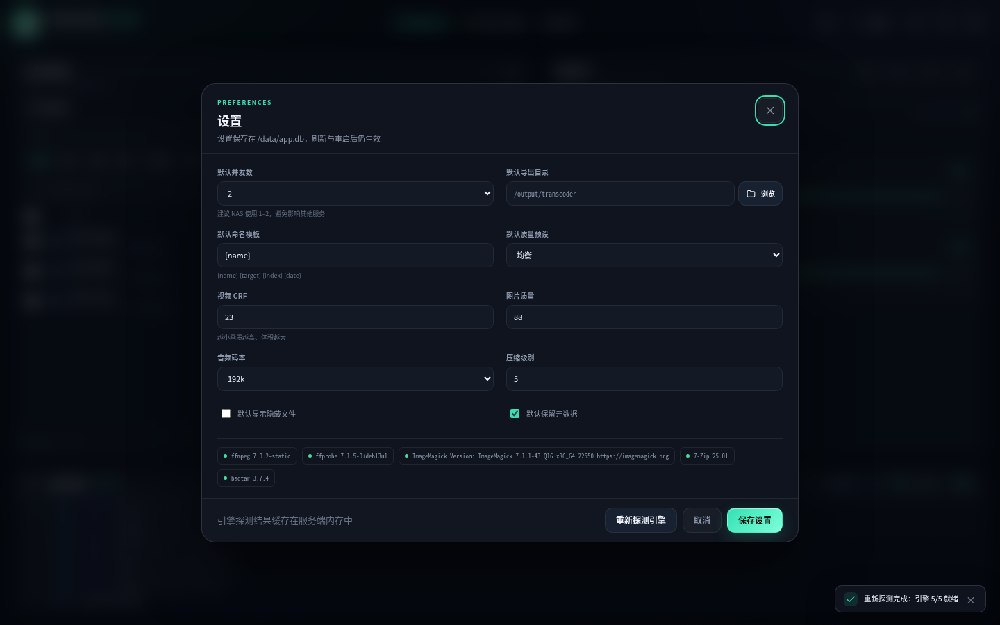
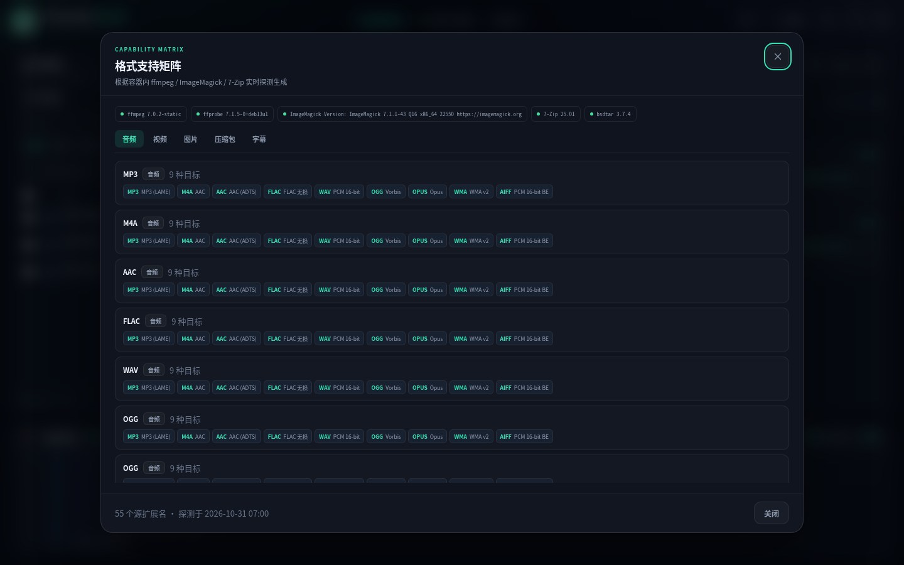
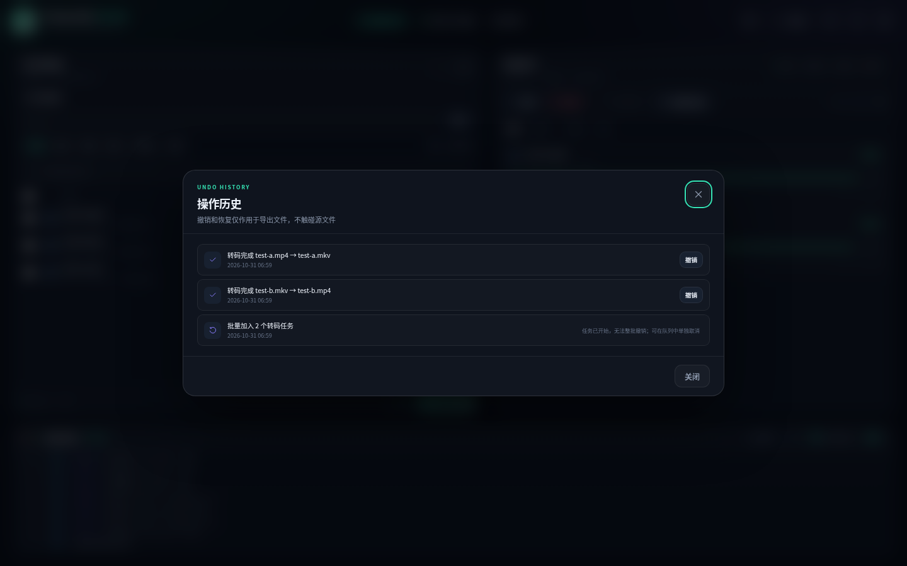

# NAS Transcode Studio

一个跑在 NAS 上的「只读源、只产新文件」通用格式转码工作台。单容器、单端口 `5124`，浏览器里浏览宿主机全部目录，批量选择文件，按文件类型选择目标格式，加入持久队列，暂停/继续/终止，刷新网页甚至重启容器都不会丢任务和日志。



> **源文件安全是最高优先级。** 源目录以 `/:/host:ro` 只读挂载；应用层又强制所有写操作只能落在 `/output`；输出先写临时文件，校验后原子发布，重名自动加序号，**绝不覆盖**任何已有文件。撤销也只操作导出文件。

## 功能

- **全 NAS 文件浏览**：`/:/host:ro`，面包屑、路径直达（输入 `/home/user` 回车直接进入）、搜索、类型筛选、隐藏文件、加载更多、跨目录多选。
- **动态格式矩阵**：启动时探测 `ffmpeg` / ImageMagick / 7-Zip / bsdtar 的真实能力，只展示当前镜像确实可编码的目标；不可用的格式不会谎报。启动探测遇到冷启动超时会自动重试，也可在「设置 → 重新探测引擎」手动刷新，无需重启容器。
- **五种文件家族**：音频、视频、图片、压缩包、字幕；视频源还可提取音频、生成 GIF 动图。
- **批量任务**：批量选择、批量目标格式、批量命名模板、逐文件单独目标格式与文件名。
- **持久队列**：SQLite 保存任务/进度/日志/设置/撤销历史；并发数 1–8 可调；全局暂停、继续、终止；单任务暂停、继续、取消、重试。
- **导出目录**：在 `/output` 卷内自由选择目录、新建文件夹；选择器同样支持直接输入路径跳转。默认 `./output`。
- **永不覆盖**：目标文件已存在时自动生成 `name (1).ext`，发布使用 `link()` / 独占创建。
- **撤销与恢复**：批量建单（尚未开始时）、修改设置、新建空目录、任务完成输出都可撤销；被撤销的输出进入 `/output/.transcoder-trash/`，可一键恢复。
- **现代 WebUI**：深色/浅色主题、实时滚动日志、自动滚动、级别筛选、状态持久，1440×900 无横向溢出。
- **构建快**：Alpine 系统包，无 pip/npm 编译，一条 `apk add` 层；**不拉取 `docker/dockerfile` frontend 镜像**，默认使用阿里云 apk 镜像。

## 界面

| 转码配置 | 设置 |
| --- | --- |
|  |  |

| 格式矩阵 | 撤销历史 |
| --- | --- |
|  |  |

## 快速开始

```bash
# 1. 把项目放到 NAS 的可写目录
mkdir -p /volume1/docker/nas-transcoder
cd /volume1/docker/nas-transcoder

# 2. 复制环境变量（默认已启用国内 apk 镜像）
cp .env.example .env

# 3. 构建并启动（首次会安装 ffmpeg/ImageMagick/7-Zip 等系统包）
docker compose up -d --build

# 4. 查看状态
docker compose ps
docker compose logs -f --tail=100
```

浏览器打开 `http://NAS_IP:5124`。

### compose 关键配置（已满足）

```yaml
ports:
  - "5124:5124"
network_mode: bridge
volumes:
  - /:/host:ro          # 整个 NAS，只读
  - ./data:/data        # 队列/设置/日志/撤销历史
  - ./output:/output    # 导出的新文件
```

默认导出到 `./output`。想直接导出到 NAS 的其他目录，修改 compose 的 `/output` 映射即可，例如：

```yaml
volumes:
  - /:/host:ro
  - ./data:/data
  - /volume1/transcoded:/output
```

应用内部看到的导出根始终是 `/output`，不能写到 `/host`。

## 使用流程

1. 左侧浏览 `/host`，进入 NAS 目录；勾选一个或多个支持转码的文件。
2. 点「加入队列」，在弹窗里：
   - 选择导出目录（可新建文件夹）；
   - 批量目标格式或逐文件目标格式；
   - 使用 `{name}`、`{target}`、`{index}`、`{date}` 模板或逐文件改名；
   - 选择质量预设，展开「高级参数」可调图片质量、音频码率、视频 CRF、压缩级别、元数据保留。
3. 提交后任务进入队列。右侧可以暂停/继续/终止、取消单任务、查看实时进度。
4. 刷新页面、关闭浏览器再打开，队列/进度/日志仍然存在；容器重启时排队任务继续保留，中断的运行任务会标为失败并可重试。
5. 顶栏「撤销」撤销最近一个可撤销操作；时钟按钮打开完整操作历史。
6. 已完成任务可撤销输出（移入回收站）或恢复输出；下载按钮直接下载生成文件。

## 安全模型（为什么不会伤到原文件）

| 层 | 保护 |
| --- | --- |
| 内核 | compose 将 `/` 挂载为 `/host:ro`，容器内对源目录的写系统调用直接失败 |
| 应用路径 | 所有源路径 `realpath` 后必须位于 `/host`；所有写路径必须位于 `/output`；`/host` 与 `/output` 不允许重叠 |
| 只读打开 | 源文件只以 `O_RDONLY` 打开校验；外部命令使用参数数组，不经过 shell |
| 临时文件 | 输出先写 `/output/.transcoder-tmp/<job>/`，任务结束清理；启动时清理残留 |
| 原子发布 | 校验输出非空、源文件指纹未变，再 `link()` 发布；目标存在则加 ` (n)`，绝不覆盖 |
| 源指纹 | 开始前记录 `size/mtime_ns/inode/抽样 SHA-256`，结束后复核；变化则不发布 |
| 归档安全 | 预检绝对路径、`..`、符号链接/特殊文件、加密包；限制条目数、解压体积与膨胀比 |
| 撤销边界 | 撤销只移动/恢复 `/output` 内本应用生成的输出，源目录永不参与 |
| 容器权限 | `read_only: true`、`cap_drop: ALL`、仅保留读取/写入挂载所需 DAC 能力、`no-new-privileges`，不挂 docker.sock，不 privileged |

> 即使有人把 `/host` 误配成可写，应用层仍会拒绝任何 `/host` 写入。但请保持 compose 中的 `:ro`。

## 格式支持

矩阵在每次启动时重新探测，当前构建（Alpine 3.20 + ffmpeg 6.1 + ImageMagick 7 + 7-Zip 23 + bsdtar 3.8）包含：

- **音频**：MP3、M4A、AAC、FLAC、WAV、OGG、OPUS、WMA、AIFF，同格式可重编码；视频可提取这些音频目标。
- **视频**：MP4、MKV、WebM、AVI、MOV、M4V、FLV、WMV、TS；视频可生成 GIF 动图。
- **图片**：JPG、PNG、WebP、AVIF、GIF、BMP（Alpine 的 ImageMagick 无 TIFF/HEIC 编码时，矩阵不会显示）。
- **压缩包**：ZIP、7Z、TAR、TAR.GZ、TAR.BZ2、TAR.XZ；**RAR 仅作为输入**（RAR 编码器是专有软件，镜像不包含，UI 不会显示 RAR 目标）。
- **字幕**：SRT、VTT、ASS。

“每个格式能转成什么”完全由 `/api/capabilities` 返回的矩阵决定，前端不硬编码假能力。

## 持久化与备份

| 路径 | 内容 |
| --- | --- |
| `./data/app.db` | SQLite：设置、任务、进度、日志（最近 5000 条）、撤销历史 |
| `./output/` | 所有生成的新文件 |
| `./output/.transcoder-tmp/` | 任务临时文件（自动清理） |
| `./output/.transcoder-trash/` | 被撤销任务的输出，可恢复 |

备份队列/设置：停容器后复制整个 `./data`。恢复时放回同一路径并启动。不要删除 `.transcoder-tmp` 之外的任务输出，否则任务记录会失效。

## 配置

环境变量（`.env` 或 compose）：

| 变量 | 默认 | 说明 |
| --- | --- | --- |
| `TZ` | `Asia/Shanghai` | 容器时区 |
| `LOG_LEVEL` | `INFO` | 系统日志级别 |
| `MAX_ARCHIVE_GIB` | `200` | 单包解压后体积上限（GiB） |
| `MAX_ARCHIVE_ENTRIES` | `2000000` | 单包条目上限 |
| `MAX_ARCHIVE_RATIO` | `200` | 解压膨胀比上限（大于 1 GiB 时检查） |
| `BASE_IMAGE` | `alpine:3.20` | 构建基础镜像，可换成镜像站地址 |
| `APK_MIRROR` | `https://mirrors.aliyun.com/alpine` | 构建参数，替换 apk 软件源；可改回官方源 |

默认并发 2。NAS 上建议 1–2，避免转码占满 CPU 影响其他服务；可在设置或队列右上角修改（1–8）。

### 加快首次构建（重要）

Dockerfile **不再包含** `# syntax=docker/dockerfile:1`。这一行会让 BuildKit 额外从 Docker Hub 拉取 `docker/dockerfile:1` frontend，在国内网络下可能卡住 2 分钟以上——你看到的 `resolve image config for docker-image://docker.io/docker/dockerfile:1 ... 119.4s` 就是这个原因。

当前 compose 默认传入：

```yaml
APK_MIRROR: ${APK_MIRROR:-https://mirrors.aliyun.com/alpine}
```

所以 `cp .env.example .env` 后直接构建即可。若基础镜像 `alpine:3.20` 本身拉取也慢，在 `.env` 中设置一个可用的镜像地址（例如 Docker 已配置的加速器地址）：

```bash
BASE_IMAGE=你的镜像站/library/alpine:3.20
docker compose build
docker compose up -d
```

如果当前构建正卡在 frontend 拉取，先 `Ctrl+C` 停止，更新 Dockerfile 后重新 `docker compose up -d --build`；已完成的层会复用。

## API（供脚本/自动化使用）

| 方法 | 路径 | 说明 |
| --- | --- | --- |
| GET | `/api/health` | 健康检查 |
| GET | `/api/bootstrap` | 首次加载：设置、能力矩阵、任务、日志、撤销 |
| GET | `/api/state?after_log=ID` | 轮询任务/进度/新日志 |
| GET | `/api/fs/list?path=/host/...` | 浏览只读源 |
| GET | `/api/output/list?path=/output/...` | 浏览导出目录 |
| POST | `/api/output/mkdir` | 新建导出目录 `{parent,name}` |
| POST | `/api/jobs` | 批量建单 `{items:[{source_path,target,output_dir,output_name}],options}` |
| PATCH/DELETE | `/api/jobs/{id}` | 编辑/删除排队任务记录 |
| POST | `/api/jobs/{id}/pause|resume|cancel|retry|restore|undo-output` | 单任务操作 |
| POST | `/api/queue/pause|resume|stop` | 全局队列操作 |
| POST | `/api/queue/clear-completed` | 清除已完成任务记录（输出文件保留，可撤销） |
| POST | `/api/queue/retry-failed` | 将所有失败任务重新排队 |
| PATCH | `/api/settings` | 修改设置 |
| GET | `/api/actions` | 操作历史 |
| POST | `/api/undo` | 撤销最近操作 |
| POST | `/api/actions/{id}/undo` | 撤销指定操作 |
| GET | `/api/download?path=/output/...` | 下载导出文件 |

所有成功响应带 `"ok": true`；失败返回 `{"ok":false,"error":{"code","message"}}` 和对应 HTTP 状态码。

## 测试

```bash
# 静态检查
python3 -m py_compile app/*.py
node --check app/static/app.js
docker compose config --quiet

# 单元 + 集成（真实音视频/图片/压缩包转码、暂停取消、撤销、持久化、安全断言）
python3 -m unittest discover -s tests -t . -v

# 容器健康与源只读检查（容器运行时执行）
sh tests/container_smoke.sh
```

测试会临时创建媒体、执行真实转码，并断言源文件 SHA-256 / mtime / 目录列表不变。完整测试也在 Alpine 3.20 rootfs 中通过。

## 上机检查清单（NAS）

- [ ] `docker compose config` 显示 `5124:5124`、`network_mode: bridge`、`/:/host:ro`。
- [ ] `docker compose up -d --build` 成功；`docker compose ps` 为 healthy。
- [ ] 浏览器打开 `http://NAS_IP:5124`，能看到 NAS 目录。
- [ ] 在 `/host` 下勾选一个文件，转码到默认 `/output`，源文件 hash/mtime 不变。
- [ ] 刷新页面，任务、进度、日志仍在。
- [ ] 暂停/继续/终止/撤销各操作一次。
- [ ] 如果 NAS 目录属主不是 root，确认容器能读取（compose 保留 `DAC_READ_SEARCH`）。
- [ ] 如果 `./output` 所在盘空间不足，改为挂载更大的 NAS 目录到 `/output`。

## 故障排查

- **打不开页面**：`docker compose logs --tail=200`；确认 5124 未被占用；`docker compose ps` 是否 healthy。
- **看不到某些目录**：确认 compose 是 `/:/host:ro` 而不是只挂载某个卷；检查目录权限。
- **无法写入导出目录**：确认 `./output` 可写、磁盘有空间；容器以 root 运行并带 `DAC_OVERRIDE`，但父目录若只读仍会失败。
- **某格式没有出现在目标列表**：说明当前镜像中的工具不支持该编码；查看顶栏「格式支持矩阵」与日志。
- **重启 NAS 后顶栏显示「引擎 0/5」、所有文件都没有目标格式**：这是容器启动时工具探测失败被缓存，不是源文件损坏。打开「设置 → 重新探测引擎」；如果仍失败，`docker compose exec -T transcode-studio sh -c 'ffmpeg -version; magick -version'`，命令正常但页面仍 0/5 时把容器日志发回。若提示 `not found` 或 `Error loading shared library`，执行 `docker compose build --no-cache` 后重建容器。
- **RAR 转不了**：RAR 只能作为输入；镜像是 `libarchive`/bsdtar 读取 RAR4/RAR5，不包含私有 RAR 编码器。
- **容器重启后任务失败**：运行中的进程无法跨重启继续，会标为失败并清理临时文件，点「重试」即可；排队任务会保留。

## 安全提醒

- WebUI 无登录，只适合可信内网；不要把 5124 直接暴露公网。公网使用请加反向代理 + 认证 + HTTPS。
- 不要给本容器挂载 `docker.sock`，不要使用 `privileged`。
- 源目录必须保持只读；不要为了“省事”把 `/output` 指到 `/host` 下。
- 撤销的输出在 `.transcoder-trash` 内不会自动清空；确认无用后可手动删除该目录下的内容。

## License

MIT License，见 [LICENSE](LICENSE)。可自由使用、修改、分发，保留版权声明即可。

## 目录结构

```
.
├── app/                   # Python 标准库后端 + 原生 WebUI
│   ├── server.py          # HTTP server / API 路由
│   ├── jobs.py            # 持久队列、调度、暂停/终止
│   ├── engine.py          # ffmpeg/ImageMagick/7z/bsdtar 命令构造与执行
│   ├── capabilities.py    # 动态能力矩阵
│   ├── security.py        # 只读路径、原子发布、指纹、命名
│   ├── db.py / service.py / config.py
│   └── static/            # index.html / app.js / style.css
├── tests/                 # 31 个单元/集成测试 + RAR 样本
├── docker-compose.yml
├── Dockerfile
├── .env.example
└── docs/screenshots/
```
